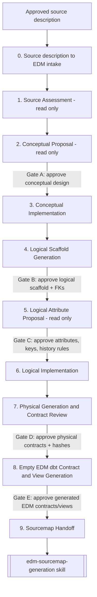

# EDM Source Modeling — Overview

This skill translates an approved source-description document into an EDM-oriented intake, then walks the source through the NLOEDM conceptual → logical → physical → empty EDM dbt contract chain. Model-layer changes remain gated by explicit user approval. Full instructions live in [SKILL.md](./SKILL.md); this file is a quick visual/orientation aid only.

## When to use it

Use this skill after `edm-source-description` has produced an approved source-description document. It creates the EDM intake, assesses a source, adds/changes conceptual entities or relationships, scaffolds logical entities, generates physical YAML, and generates empty EDM dbt views — **before** source-to-EDM dbt mapping work (that handoff goes to `edm-sourcemap-generation`).

## Guiding principles

- **Gated workflow** — no shared-layer edit or converter run without explicit approval for that stage.
- **UDM / ontology-style generalization** (Len Silverston) — prefer generic, heavily-typed, reusable entities (`party`/`party_role`, `<concept>_type`, supertype/subtype) over source-shaped, narrow entities.
- **Domain grounding** — NLOEDM models a company that files/manages patent and IP matters on behalf of customers and agents; think in terms of `work_effort` (matters), `party`/`party_role` (applicant, agent, inventor, examiner), and IP-specific type classifiers (jurisdiction, right type, status, deadline/action).

## Workflow at a glance

## Stage-to-artifact map

| # | Stage | Output | Approval gate |
|---|-------|--------|----------------|
| 0 | Source description to EDM intake | Reviewed source intake | Intake confirmation |
| 1 | Source Assessment | Assessment notes (read only) | — |
| 2 | Conceptual Proposal | Proposed entities/relationships (read only) | **Gate A** |
| 3 | Conceptual Implementation | `NLOEDM_conceptual.yml` | — |
| 4 | Logical Scaffold Generation | Generated logical entities/FKs | **Gate B** |
| 5 | Logical Attribute Proposal | Attribute/key/history proposal (read only) | **Gate C** |
| 6 | Logical Implementation | `NLOEDM_logical/*.yml` | — |
| 7 | Physical Generation and Contract Review | `physical.<entity>.yml`, OKF Markdown docs | **Gate D** |
| 8 | Empty EDM dbt Contract and View Generation | `models/edm/*.sql`, `models/edm_history/*.sql`, `_models.yml` | **Gate E** |
| 9 | Sourcemap Handoff | Handoff package to `edm-sourcemap-generation` | — |

## Key inputs

- Approved source description: [edm-source-description template](../edm-source-description/assets/source-description.md).
- EDM-oriented source intake: [assets/source-intake.md](./assets/source-intake.md) template.
- `NLOEDM/index.md` to discover reusable existing entities before proposing new ones.

See [SKILL.md](./SKILL.md) for the full gated instructions, checks, and converter safety rules.
