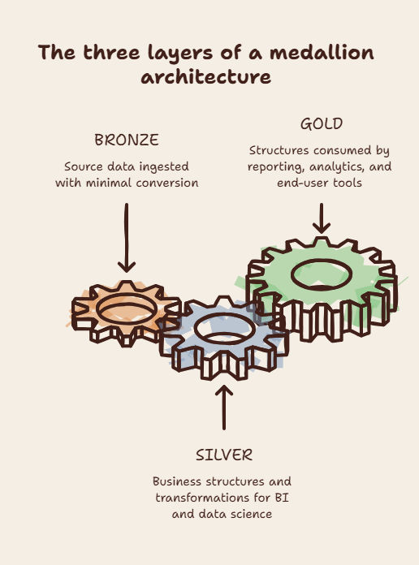
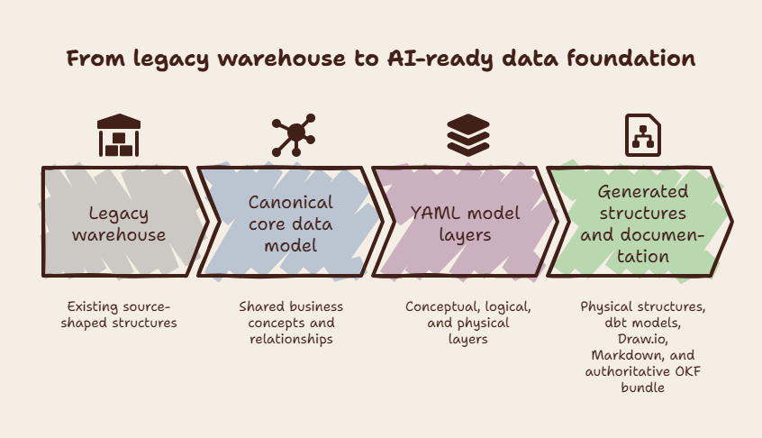

<!-- REVIEW:START -->
> ## Review
>
> **Publishable: 4/5** — the article now makes a clear, grounded case for the series and needs only light publication edits to sharpen its hook and consistency.
>
> **Intended audience: Both**
>
> **Manager (M): 4/5** — the business case and the architectural change are clear without borrowed authority or unnecessary implementation syntax.
> **Technical (T): 4/5** — the Party example and conceptual/logical YAML overview establish the approach while appropriately reserving technical depth for later tracks.
>
> **What to change**
>
> 1. Retitle the article with a shorter, declarative headline that names the architectural problem and removes the conversational "The why and most importantly, the how."
> 2. Make the opening sentence of "The medallion architecture" more direct by replacing "It starts with" with a statement of why the architecture is relevant to the argument.
> 3. Make the layer labels consistently sentence-cased or title-cased, and add the missing period to "The third track explains how AI is used in this new environment."
> 4. Do a final visual pass for double spaces and trailing whitespace before publishing.
>
> **Platform fit**
>
> Medium: 5/5 — a strong long-form anchor; publish after the title is tightened.
> LinkedIn Newsletter: 4/5 — publish with a short introductory note that states the professional problem and invites readers into the series.
> dbt Slack / Blog: 2/5 — reserve this introductory piece for your own channels; the later dbt implementation articles will give this community more practical value.
> r/dataengineering: 4/5 — frame the post as a discussion question about whether medallion layers provide enough semantic structure for AI, rather than a series announcement.
>
> _Reviewed against: 01_project_summary, 02_core_principles, 05_style_and_voice, 06_content_boundaries. Date: 2026-09-06._
<!-- REVIEW:END -->

Intended audience: both manager and practitioner

# The Journey to an AI-Ready Data Warehouse
This series explains why we began a major restructuring of our legacy data warehouse, how we approached it and how we implemented the restructuring. 

The series will also identify what we learned along the way. What works, what does not work. 

## The AI era
We have all read of ambitious promises about AI. Machines will answer questions before we ask them, automate work, and remove people from processes. These predictions shape how organisations think about the immediate future. At conferences for data professionals, many presentations show what AI can do with data. AI can handle data and provide answers, but the demonstrations often use simple data structures that do not reflect the complexity of a real business environment.

## The goal 
The central question we must find an answer for is how we can use AI to improve the quality of analytics work, increase the throughput of business requests, and reduce the time and cost involved. The practical question is what we must do to structure enterprise data so that it provides AI with the meaning it needs to deliver those benefits.

### The medallion architecture

The medallion architecture is the most wildely used by data practitioners. In this architecture the process of transforming data into information focuses on dividing the process into three distinct phases:

- bronze: the layer where data is ingested with minimal conversion
- silver: the layer where source data is translated into business structures and transformed for BI and data science
- gold: the layer consumed by reporting, analytics, and other end-user tools

The medallion architecture is a process architecture: it tells you where transformation occurs, not what the data should look like. What it lacks is an information architecture — a defined shape for each layer, with explicit rules, a specified input and output, and documentation that both people and machines can read.

A medallion architecture is often implemented as a free-form transition from source systems to gold structures. For years, teams were told that this did not matter: structure slowed delivery, new information had to be created quickly, structure by structure.

<figure>
  
  <figcaption>Figure 1. Bronze, Silver, and Gold define transformation stages; explicit information architecture defines data shape, relationships, and meaning.</figcaption>
</figure>

### Lacking documentation
Legacy source systems often have cryptic table and attribute names. They offer little information about relationships. The relationships exist, but they are often not described. Knowledge of their meaning is assumed. Measures are often sparsely described and can have different meanings in different contexts.

The medallion architecture has no inherent documentation requirements. This lack of documentation was not a priority, because there were always gatekeepers. The gatekeepers new about the meanining of tables and clumns. They made sure that the correct joins were made and the right measures were chosen. AI requires this structure and documentation to derive meaning from the data.

We need a new foundation on which to build.

## The new architecture  
The requirements of LLMs make what was once optional or an afterthought essential to successful operation. We need a clear set of rules:

- all the data needs to have a clear structure, with explicit meaning
- relationships between entities become primary citizens and far more important than in the past
- all the data needs to be fully described in natural language

### The enhanced medallion architecture

This means that we must enhance the medallion architecture with the following requirements:

1. The bronze layer preserves source data in a predefined structure. It needs to be historized.
2. The medallion architecture gains a canonical core data model that provides the required structure for AI tooling.
3. The core data model uses universal business concepts, so source-system specifics are grounded in general concepts. Relationships are first-class citizens in the model.
5. Documentation describes the structures and data in a form that links the data to LLMs and supports reasoning.
6. Gold models use the core data model as their source, which requires additional transformation steps.

What we end up with is:

- bronze: the ingestion layer, with source data held in a defined and historised format
- silver: the layer that translates source-system data into the canonical model and adds business meaning
- core data model: the fully documented canonical model where the new business structure resides
- gold engineering: the layer that transforms the canonical model into structures ready for BI and data science tools
- gold: the end-user layer, where fully described metrics and KPIs are available for consumption

The additional layers make responsibilities and handoffs clearer for people and AI systems. It decouples the ingestion of data from the presentation of data. It limits interdependencies and allows working on the layers simultaneously.  

<figure>
  
  <figcaption>Figure 2. A documented Core Data Model separates source-to-canonical mapping from the preparation of data for BI, data science, and end-user metrics.</figcaption>
</figure>

Central to this enhanced medallion architecture is a data model based on universal business concepts and the principles set out by Len Silverston in his Universal Data Models.

### Universal data model as the chosen architecture for the new core data layer
The core data model needs an architecture. For AI the work from Len Silverstone on datamodels offers a good basis that fits well with the requierements from AI.

Len Silverston’s Universal Data Model (UDM) architectural principles focus on creating stable, reusable, and business‑aligned data structures that can endure change over time. 

The core idea is to model the business in terms of fundamental business concepts—called subject areas—such as Party, Product, Agreement, Location, and Event, rather than around specific applications or reports. These models emphasize semantic consistency, meaning the same concept (for example, a Customer as a role held by a Party) is defined once and reused everywhere, reducing redundancy and integration friction. UDM promotes separation of core entities from their roles, states, and classifications, allowing flexibility as business rules evolve without restructuring the data model. 

Because these models create clean, semantically consistent, and well-governed representations of business meaning, AI systems can more easily understand, relate, and reason over the data. The separation of core entities from roles, classifications, and states reduces ambiguity, which is critical for LLM-based reasoning. 

#### A simple Party example
Consider an organization that is a customer and later becomes a supplier. A source-shaped warehouse would often create separate customer and supplier records, even though both records describe the same organization. A UDM represents the organization once as a Party and records each business context through Party Role: Customer and Supplier. The roles can exist at the same time or have their own effective dates.

The same pattern applies to people. One person can be an Employee, an Applicant, and an Inventor without duplicating their identity or contact details. The Party entity holds the common identity and relationships; Party Role records the context in which the person or organization participates. A subtype is added only when a particular form of Party has durable attributes or relationships that do not apply to other Parties.

## The journey

We began a project to prepare the data warehouse for this AI era.

### Adding a core data model 
Our data warehouse lacks this core data model: the central layer that emphasises business meaning over source-system structure. Adding it also changes the way data is ingested.

- All source-ingestion processes must route data into these structures.
- All gold models must use the core data model as their source.

### YAML structures used to model the core data model
The core data layer uses a lightweight, YAML-based implementation of conceptual, logical, and physical data models.

We wanted to make the project as portable as possible, so we used YAML and Draw.io to develop the new data model. Many legacy data-modelling tools are expensive, complex, and tied to proprietary data formats. Builing everything in YAML allows us to achieve the same, without the overhead of these tools. 

#### The conceptual layer YAML
The conceptual layer contains:

- entity names
- labels
- descriptions
- entity types

- fully described relationships
  - relationship names
  - labels
  - source entities
  - target entities
  - cardinality

#### The logical layer YAML
The logical layer is kept in sync with the conceptual layer. It contains all the information from the conceptual layer but adds:

- derived-from links to identify the conceptual property each logical element implements
- primary keys
- business keys
- historisation rules

- fully described attributes
  - attribute names
  - attribute descriptions
  - data types
  - confidentiality flag

### Automation with Python and AI

Plain YAML files, a helper application developed in Python, and AI skills support the creation of new entities and synchronisation between layers. The data model remains central, while AI and Python help automate the generation of physical structures and dbt models.

Draw.io and Markdown describe and present the model. A generated OKF bundle grounds AI and serves as the authoritative description of the core data model.

This combination allows us to reduce dependence on legacy modelling tools while still working efficiently. 

<figure>
  
  <figcaption>Figure 3. The journey builds an AI-ready data foundation by making business meaning explicit and carrying it through modelling, generation, and documentation.</figcaption>
</figure>

### Microsoft warehouse with dbt as the physical implementation
The whole process is implemented as a Microsoft Fabric warehouse. The transformation processes are implemented in dbt.  

### The technology stack
- YAML for data modelling
- Microsoft Fabric Warehouse as the data store
- dbt to generate the core data layer and perform transformations
- Python tooling to keep the model layers in sync and generate documentation in Draw.io and Markdown
- an OKF bundle to provide AI with the required contracts for the core data layer
- AI skills to support the modelling flows and the generation of dbt models

## The article series
This article series focuses on this new foundation and is based on a real transition. It details the architectural choices and the implementation, showing how the architecture was built with YAML, Draw.io, dbt, and Microsoft Fabric.

It hopes to help other professionals who want to make the same journey, but also hopes to encourage feedback.

## What we wanted AI to enable with the transformation
The foundation described in this series was designed to give AI the context and structure needed to work with enterprise data. We wanted it to enable:

- semantic grounding for text-to-SQL and natural-language querying, reducing confident but incorrect answers
- AI assistance in designing and maintaining a high-quality data model
- faster source onboarding through source-to-concept mapping
- broader participation in data-platform work by reducing dependence on scarce specialist knowledge
- dynamic Gold models and on-demand analytical structures
- living documentation and a knowledge graph that remain useful to people and AI tools

## The tracks
It is structured into four tracks. 

The first track focuses on why particular architectural decisions were made. Many options are available, and this track explains the thinking behind the choices.

The second track focuses on the model and the toolchain. It details how to create a YAML-based data model with conceptual, logical, and physical layers, and how that model can generate structures in Microsoft Fabric and dbt.

The third track explains how AI is used in this new environment

The fourth track focuses on the dbt and Microsoft Fabric implementation.

The articles are written from the perspective of a practitioner who has made the choices, lives with the consequences, and is still working through the details. Nothing here is presented as the only right answer. The goal is to share a coherent, working approach and to give other professionals enough to evaluate, adapt, and build on.

The next article in the series explains why the medallion architecture needs a canonical Core Data Model.