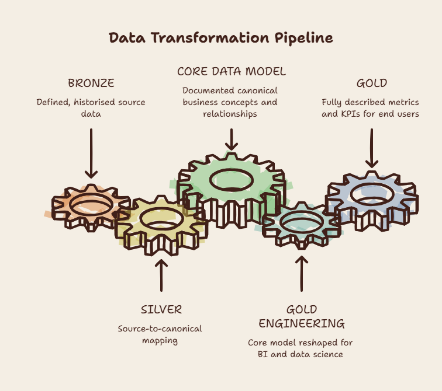
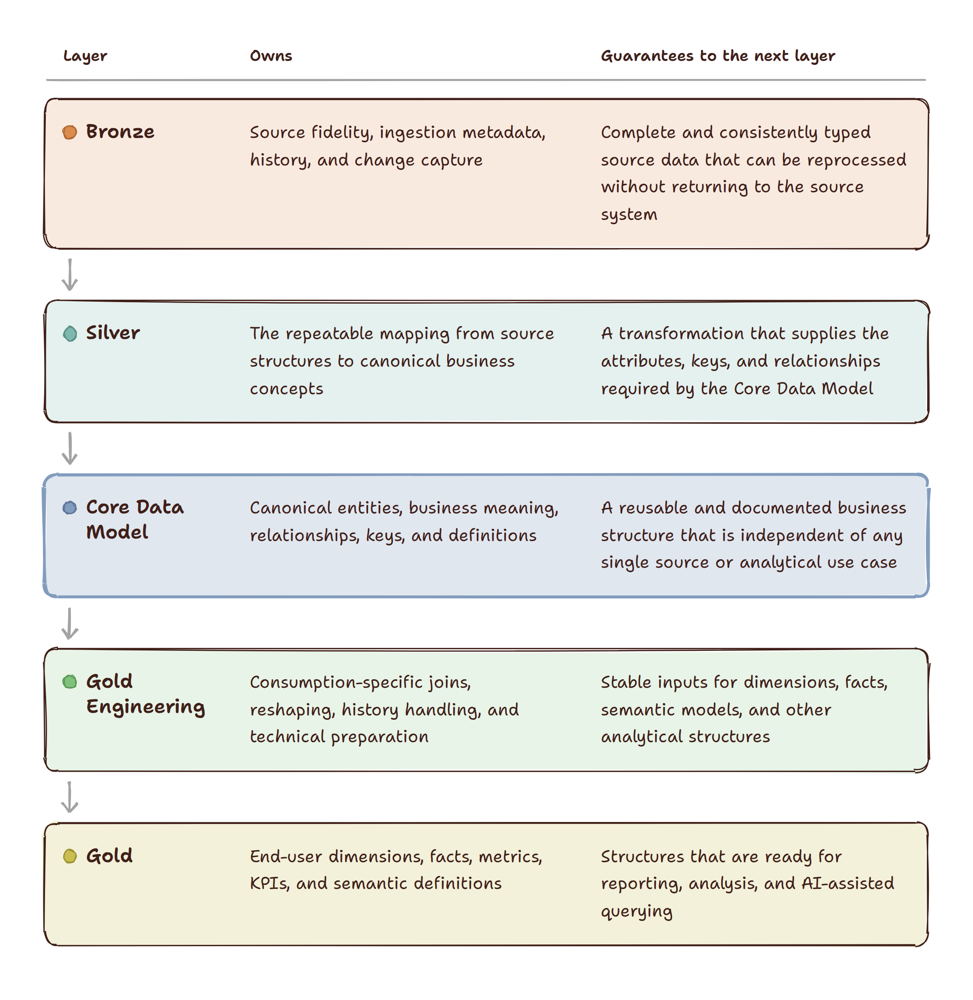
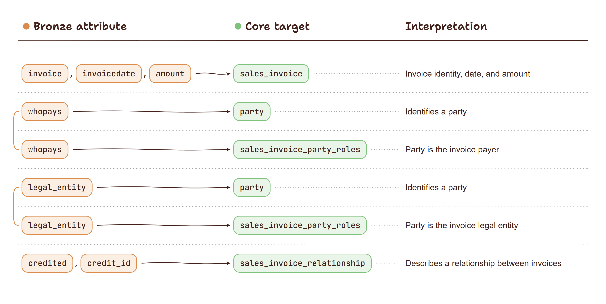

<!-- REVIEW:START -->
> ## Review
>
> **Editorial publishability: 4/5** — the architecture is coherent, the Silver fan-out is now demonstrated concisely, and only light compression and final copy editing remain.
> **Proofreading gate: Required** — the existing report predates the correction pass, so the article needs a fresh proofreading check.
>
> **Intended audience: Both**
>
> **Manager (M): 4/5** — the layer contracts, reduced-coupling argument, and explicit governance costs now make the architectural decision understandable, with only a sharper conclusion still needed.
> **Technical (T): 4/5** — the source-to-Core mapping table and compact Silver patterns show how one source feeds multiple canonical structures without overwhelming the architecture discussion.
>
> **What to change**
> 1. Reduce the remaining Gold SQL to the smallest excerpt needed to support the architectural argument, leaving the production implementation for the implementation track.
> 2. Rename "The generic ingestion template for sales invoice" to reflect that the section now presents an illustrative mapping rather than a complete generated template.
> 3. Run a fresh proofreading pass now that the earlier reported corrections and Silver simplification have been applied.
>
>
> **Platform fit**
>
> Medium: 4/5 — strong long-form fit; shorten the remaining Gold SQL before publication.
> LinkedIn Newsletter: 4/5 — the architecture and management trade-offs are suitable; add a brief opening that states the organisational problem immediately.
> dbt Slack / Blog: 3/5 — the contract-driven Silver mapping is relevant, but frame the post around dbt model contracts and source-to-Core mapping rather than the full architecture.
> r/dataengineering: 4/5 — the added Core layer and reduced coupling create a useful architecture discussion; present the post as a trade-off question to invite debate.
>
> _Reviewed against: 01_project_summary, 02_core_principles, 05_style_and_voice, 06_content_boundaries. Date: 2026-09-20._
<!-- REVIEW:END -->

**01.** The enhanced medallion architecture

*The medallion architecture is a popular data warehouse design, but Bronze, Silver, and Gold layers alone don’t define what business data should mean or how it can be reused. This enhanced medallion architecture adds a canonical Core Data Model and clear data contracts to make analytics more consistent, adaptable, and easier to build*

The medallion architecture is one of the most recognisable architecture models used by data practitioners:

- Bronze: ingestion
- Silver: transformation
- Gold: analysis

The medallion architecture describes where steps from source to target structures should be modelled. It gives each layer a place in the lifecycle, but leaves much of the responsibility for structure, meaning, and transformation rules to the engineers implementing it.

This creates a problem for a changing data warehouse. Changes require knowledge of existing structures and dependencies, and a lack of shared structure can lead to duplicated models and fragile downstream relationships. AI can help with coding and reasoning, but it needs explicit structure and documentation to produce reliable results.

<figure>
  
  <figcaption>Figure 1. A documented Core Data Model separates source-to-canonical mapping from the preparation of data for BI, data science, and end-user metrics.</figcaption>
</figure>

The proposed architecture adds the following components:
- an enhanced Bronze layer that preserves source data under a clear contract
- a canonical Core Data Model that represents business concepts
- a Silver layer that maps source data into the Core Data Model
- Gold engineering and Gold layers that prepare and expose analytical structures

Each layer has a separate responsibility and a defined handoff to the next layer:

<figure>
  
  <figcaption>Figure 2. Each layer owns a distinct responsibility and provides a defined guarantee to the next stage of the enhanced medallion architecture.</figcaption>
</figure>

<!-- MEDIUM:EXCLUDE:START -->
| Layer | Owns | Guarantees to the next layer |
|---|---|---|
| Bronze | Source fidelity, ingestion metadata, history, and change capture | Complete and consistently typed source data that can be reprocessed without returning to the source system |
| Silver | The repeatable mapping from source structures to canonical business concepts | A transformation that supplies the attributes, keys, and relationships required by the Core Data Model |
| Core Data Model | Canonical entities, business meaning, relationships, keys, and definitions | A reusable and documented business structure that is independent of any single source or analytical use case |
| Gold Engineering | Consumption-specific joins, reshaping, history handling, and technical preparation | Stable inputs for dimensions, facts, semantic models, and other analytical structures |
| Gold | End-user dimensions, facts, metrics, KPIs, and semantic definitions | Structures that are ready for reporting, analysis, and AI-assisted querying |
<!-- MEDIUM:EXCLUDE:END -->

### The cost of the additional structure
The additional layers introduce real delivery and governance costs:

- modelling effort is required to define canonical entities, relationships, keys, and history behaviour before implementation can begin
- every source requires a governed mapping into the Core Data Model, including decisions about meaning, grain, identity, and missing values
- contracts and documentation must be versioned, reviewed, validated, and kept aligned with generated physical
- teams need clear ownership for approving semantic changes and managing their effect on downstream models

These costs can be offset by the clarity the structure brings in the process. When making modification it is clear where and how these have to be applied. This makes it easier for humans and AI to apply the correct modifications. 

The new structure reduces interdependency across the warehouse. A source-system change can often be handled in the Silver mapping while the Core structure and Gold models remain stable. A new reporting requirement can be developed in Gold Engineering without changing source ingestion. Multiple teams can work against the same documented Core contract, allowing source onboarding and analytical development to proceed in parallel.

The trade-offs are worthwhile when the warehouse serves multiple sources, business areas, or analytical use cases. Smaller environments with few sources and limited change may gain less from the additional governance.

### Bronze layer enhanced
The Bronze layer is where source data lands. Its purpose is to preserve source fidelity while providing consistent metadata and history for downstream processing.

The Bronze layer has the following requirements:

- preserve a permanent store of source data and its history
- capture source changes, including soft and hard deletes
- minimise modifications to source structures
- preserve and harmonise data types
- identify surrogate and business keys
- record load time, record source, process identifiers, hashes, and CDC information

For example, a simplified invoice source can be retained in Bronze with its source attributes and ingestion metadata:

```sql
select
    a.[id],
    a.[sid],
    cast(a.[invoice] as varchar(45)) as [invoice],
    a.[user],
    cast(a.[invoicedate] as datetime2(3)) as [invoicedate],
    a.[legal_entity],
    a.[primary_key_hk],
    a.[record_hk],
    a.[cdc],
    a.[load_datetime],
    a.[process_run_id],
    a.[record_source]
from [invoices] a
```
### The new canonical (Core) Data Model
The Core Data Model is the heart of the architecture. It contains structures with defined business meaning, relationships, keys, and history behaviour.

For the invoice example, the Core can contain a sales invoice, invoice lines, invoice types, invoice party roles, party-role types, and relationships between invoices. A source table can therefore be translated into several related business concepts rather than remaining a single source-shaped structure.

The logical layer documents these structures and provides the basis for the physical YAML layer and generated implementation artefacts. It is also represented as an OKF bundle so that the same definitions can be used by people and AI systems.

##### YAML example of sales_invoice
```yaml
id: logical.sales_invoice
label: Sales invoice
entity_type: regular
derived_from: conceptual.sales_invoice
keys:
  primary:
    - sales_invoice_key
  alternate:
    - sales_invoice_id
    - record_source
    - sales_invoice_type_key
columns:
  - name: sales_invoice_key
    type: string
    description: Stable key for the canonical invoice
  - name: sales_invoice_type_key
    type: string
    description: Classifies the invoice
  - name: invoicedate
    type: datetime
    description: Date of the invoice
relationships:
  - name: contains
    target: sales_invoice_lines
    cardinality: 1:N
  - name: involves
    target: sales_invoice_party_roles
    cardinality: 1:N
history:
  strategy: driving_key_set
  driving_keys:
    - sales_invoice_key
```
The generated documentation in markdown files captures entity descriptions, keys, relationships, columns, history behaviour, and Silver ingestion templates. It serves both humans and AI.

### The Silver layer: contract-driven ingestion
Silver is the controlled boundary between source-shaped Bronze data and the canonical Core Data Model. Its purpose is to interpret source attributes and map them into the entities, relationships, keys, and history rules defined by the Core contract.

The Silver layer does not invent its target structure. For each Core entity, the modelling process generates a predefined ingestion template so that a uniform shape is enforced. The template specifies:

- the target entity and its required columns
- the primary and foreign-key components
- the expected business attributes and data types
- required metadata and history columns
- the relationships that must be resolved

Source specific SQL is used to transform source structures into the shape desired by the template. It identifies the relevant Bronze attributes, applies business rules, derives missing values, resolves references, and produces a view with the exact shape required by the Core entity.

A single source table can provide data for several Core entities. For example, an invoice source may populate the Sales Invoice, Party, Party Type, and Sales Invoice Party Role entities. Each mapping is implemented independently, but every output conforms to a documented Core contract.

This gives Silver a consistent responsibility: source interpretation happens in Silver, while canonical business meaning is defined and governed by the Core Data Model.

#### The silver example
The invoices table contains the following attributes:
- [id] --> surrogate key in source system 
- [sid] --> id for the debtor (a party in a role)
- [setupdate] --> the date invoice has been setup (an attribute of the invoice)
- [invoicedate] --> the date of the invoice (an attribute of the invoice)
- [invoice] --> invoice number (an attribute of the invoice)
- [currency] --> currency of invoice (an attribute of the invoice)
- [user] --> the user who has processed the invoice (a party in a role)
- [legal_entity] --> the id of the issuer of the invoice (a party in a role)
- [credited] --> flag indicating if the invoice was credited 
- [credit_id] --> id of the credit invoice (a relationship with another invoice)

This one table feeds several canonical entities:
<figure>
  
  <figcaption>Figure 3. One Bronze invoice row supplies invoice identity, party roles, and relationships to several Core targets.</figcaption>
</figure>

<!-- MEDIUM:EXCLUDE:START -->
| Bronze attribute | Core target | Interpretation |
|---|---|---|
| `invoice`, `invoicedate`, `amount` | `sales_invoice` | Invoice identity, date, and amount |
| `whopays` | `party` | Identifies a party |
| `whopays` | `sales_invoice_party_roles` | Party is the invoice payer |
| `legal_entity` | `party` | Identifies a party |
| `legal_entity` | `sales_invoice_party_roles` | Party is the invoice legal entity |
| `credited`, `credit_id` | `sales_invoice_relationship` | Describes a relationship between invoices |
<!-- MEDIUM:EXCLUDE:END -->

The same Bronze row can therefore contribute to an invoice entity, one or more party entities, and the relationships between them. Each target has its own predefined template and independent Silver mapping.

#### The generic ingestion template for sales invoice
The generated template defines the required output columns and key components. The source-specific SQL fills the template with the relevant Bronze attributes and business rules.
```sql
-- Silver output: one row per sales invoice
select
    'sales invoice' as sales_invoice_type,
    cast(a.invoice as varchar(50)) as business_key,
    cast(a.invoice as varchar(50)) as business_description,
    a.billguideno as sales_invoice_id,
    a.invoicedate,
    a.amount,
    a.record_source,
    a.load_datetime,
    a.cdc
from bronze_invoices a
```
The output conforms to the `sales_invoice` contract. The source-specific mapping supplies the values; the target structure comes from the predefined template.

The party-role mapping demonstrates a different transformation pattern. Source columns become rows in the canonical relationship structure:
```sql
-- Silver output: one row per invoice-party-role relationship
select
    invoice_id,
    party_id,
    role_name,
    party_type
from bronze_invoices
unpivot (
    party_id for source_attribute in (whopays, legal_entity)
) roles
join role_definition
    on roles.source_attribute = role_definition.source_attribute
```
`whopays` and `legal_entity` are source attributes, while the Core Data Model represents them as relationships. Silver converts those columns into rows in `sales_invoice_party_roles` and assigns each relationship a controlled role such as `invoice payer` or `invoice legal entity`.

### Gold built on top of the Core Data Model
The Gold layer is the layer in which the structures for analysis are created. 

Prime candidate for the architecture here is a dimensional model. This provides a clear way of organising the data into structures that can be used by analytical tools. 

Having a Core Data Model as the source helps the Gold layer to have a well-documented, well-structured source. All the source entities are clearly defined and adhere to the same principles. 

This makes creating source structures a lot easier. No need to try to find how information is stored. All the business concepts are already laid out and the meaning is well documented. We just build on the core model to build metrics and KPIs where needed.

#### Example: Invoice dimension
A simplified invoice dimension would be created from the invoice itself and the parties that are related to the invoice.

The invoice details are to be found in the sales invoice entity. The parties related are found in sales invoice party role, with the different types listed in sales invoice party role type. 

To flatten the structure we need to pivot the results of sales invoice party role for each type that we select. The example outputs one row per invoice, with the parties that are related to it.

``` sql
with cte_sales_party_roles_selection as (
  select
    sipr.sales_invoice_hk
    , sipr.party_hk
    , siprt.business_key as sales_invoice_party_roles_type_business_key
  from [sales_invoice_party_roles] sipr
  inner join [sales_invoice_party_role_types] siprt
    on sipr.sales_invoice_party_role_types_hk = siprt.sales_invoice_party_role_types_hk
  where siprt.business_key in ('invoice payer', 'invoice legal entity', [invoice location])
)
, cte_sales_party_roles as (
  select
      p.sales_invoice_hk
    , p.[invoice payer] as party_hk_invoice_payer
    , p.[invoice legal entity] as party_hk_legal_entity
  from cte_sales_party_roles_selection src
  pivot (
    max(party_hk)
    for sales_invoice_party_roles_type_business_key in ([invoice payer], [invoice legal entity], [invoice location])
  ) p
)
select si.sales_invoice_hk
  , si.business_key as invoice
  , si.invoicedate
  , pip.business_key as invoice_payer  
  , ple.business_key as legal_entity
from [sales_invoice] si
    left join cte_sales_party_roles ipr on si.sales_invoice_hk = ipr.sales_invoice_hk
    left join [party]  pip on ipr.party_hk_invoice_payer = pip.party_hk
    left join [party]  ple on ipr.party_hk_legal_entity = ple.party_hk
```
#### AI usage
The structured Core Data Model is the basis that AI can use to generate Gold models. The business concepts listed are recognisable, which allows reasoning and generation of code. 

#### Automation with macros
The pattern laid out in the example will repeat itself for many dimensions, and lends itself to dbt macros that simplify the generation of the end result. There are several patterns that can be implemented as macros to speed up the creation of Gold structures and simplify maintenance. 

- generation of SCD type 2 dimensions from related core entities
- generation of integer surrogate keys to optimize joins in business intelligence tooling

The next article examines the Universal Data Model principles behind the Core Data Model. These principles explain how entities, types, subtypes, and roles provide a reusable vocabulary for representing business meaning across sources and analytical use cases. They also explain why the documented Core can guide valid joins, help map new sources into established business concepts, and provide a reliable foundation for generating Gold models.
