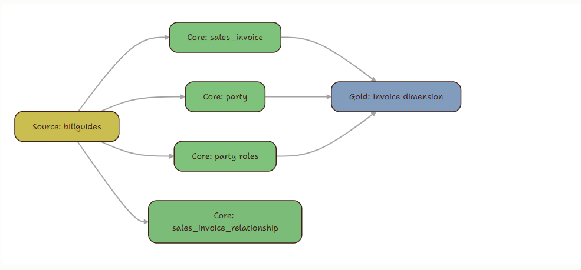
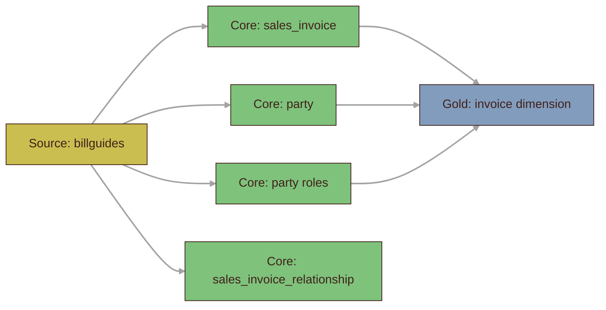
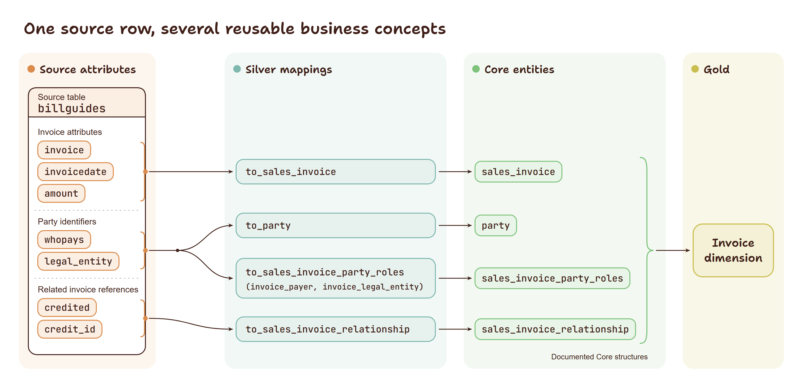

<!-- REVIEW:START -->
> ## Review
>
> **Editorial publishability: 4/5** — the UDM argument and two-path history comparison are coherent, while the ontology sections still repeat parts of their boundary explanation.
> **Proofreading gate: Required** — no proofreading report exists for this draft after its recent revisions.
>
> **Intended audience: Both**
>
> **Manager (M): 4/5** — the shared vocabulary and AI payoff are clear, while the modelling and governance effort still needs a sharper closing takeaway.
> **Technical (T): 4/5** — the `billguides` mapping and alternative history implementations are concrete, though the ontology discussion adds length without an equally concrete example.
>
> **What to change**
> 1. Compress "Why UDM resembles an ontology" and the following gap list so the shared semantics and the missing inference capabilities are stated once each.
> 2. Name the ongoing cost of source mapping, temporal rules, and semantic change control in "The architectural consequence".
> 3. Tie the `billguides` example's payer and legal-entity roles back to the earlier distinction between a party's form and its role.
>
> **Platform fit**
>
> Medium: 4/5 — the argument stands alone; trim repetition in the ontology comparison.
> LinkedIn Newsletter: 4/5 — the business relevance is present; foreground the source-onboarding payoff in the opening.
> dbt Slack / Blog: 3/5 — the source mapping is relevant; foreground the dbt implementation angle over ontology background.
> r/dataengineering: 4/5 — the two history approaches invite discussion; frame the trade-off as the post's opening question.
>
> _Reviewed against: 01_project_summary, 02_core_principles, 05_style_and_voice, 06_content_boundaries. Date: 2026-09-28._
<!-- REVIEW:END -->

# Why AI Reasons Better with a Universal Data Model
*An AI-ready data warehouse needs more than organised tables: it needs clear definitions of business concepts and how they relate. This article explains how a Universal Data Model (UDM) provides that shared structure, how it compares with an ontology, and what it can give AI systems to work with.*

The previous article introduced the core data model as the layer between source-oriented transformation and analytical consumption. This article explains one way to design that layer: the Universal Data Model, or UDM.

A UDM describes an organisation's data through stable business concepts. It gives those concepts precise definitions, identifies their relationships, and records the rules that distinguish one form of a concept from another. The result is a model that can absorb new source systems without adopting each source system's vocabulary as the warehouse vocabulary. That property matters to people building the warehouse. It also matters to AI systems. An AI tool can reason more reliably when the data model expresses what its entities mean, how they relate, and which distinctions carry business significance.

## A model of business concepts
A Universal Data Model is usually expressed as a normalised, third-normal-form model. Its entities represent business concepts rather than application tables. A `Party`, for example, represents an individual or organisation with which the business has a relationship. It remains meaningful whether a source application calls the same thing a customer, vendor, contact, account, or employee.

Normalisation provides useful discipline here. A concept has one authoritative representation; facts that belong to a distinct concept have their own home; and relationships are recorded directly instead of copied into multiple tables. The model can therefore preserve the meaning of data as it moves between systems and reporting structures. This is not a claim that every source table maps one-for-one to an entity. Source applications are designed to support their own workflows. They often combine several concepts in one table, use generic lookups for unrelated classifications, or assign a technical name that no longer describes the business use. The core model translates those choices into a shared business language.

## Types, subtypes, and roles
UDM uses three related techniques to represent variation without creating a separate entity for every familiar application label: types, subtypes, and roles. They answer different questions.

### Types describe enduring forms
A type distinguishes recognised forms of a single concept that share the same basic structure. For `Party`, the foundational distinction is commonly between a `Person` and an `Organisation`. Both can have names, addresses, identifiers, and contact methods. Each form can still carry values that are particular to it. The important modelling decision is that a person and an organisation remain parties first. Downstream users can ask about all parties, while specialised processes can use the relevant type. This preserves a common relationship structure: an address can belong to either kind of party; a case can involve either kind; a contract can name either as a counterparty.

### Subtypes carry attributes that genuinely differ
A subtype is appropriate when a form of an entity needs its own attributes, rules, or relationships. It inherits the identity of its parent entity and adds the structure that only applies to that form.

For example, an `Organisation` may need a registration number and incorporation jurisdiction. A `Person` may need date-of-birth data. These attributes should not become a wide collection of mostly empty columns on `Party`, and they should not be duplicated across unrelated application tables. The subtype makes the difference explicit and keeps the parent concept coherent.

A subtype earns its place when the difference is structural. It should represent more than a convenient label used by one source system.

### Roles describe context and can change over time
A role describes how a party participates in a particular business context. A party can be a customer in one relationship, a supplier in another, an employee during a period of employment, and a contact for an organisation at the same time. Those states can begin and end, and several can coexist. This is why `Customer` and `Employee` often fit better as roles than as subtypes. A customer can be a person or an organisation. An employee is a person, but employment also has context: employer, position, start date, end date, and terms. Modelling a role or engagement gives that context somewhere to live and supports its history.

The distinction prevents a common source-driven design from leaking into the core model. Separate `customer` and `employee` tables may make sense inside operational applications, yet they hide that the same human being can be both. A UDM represents the shared party once and attaches the relevant classifications and relationships.

## A small example
Consider two source systems. A sales system supplies a `Customer` table. An HR system supplies an `Employee` table. Both contain names, addresses, email addresses, and identifiers. A source-led warehouse would likely retain two separate structures and create matching transformation logic for every downstream model.

A UDM starts with the questions that survive the source systems:

- Who or what is the party?
- Is the party a person or an organisation?
- Which details identify or describe that party?
- In which business relationship does the party act as a customer, employee, supplier, or contact?
- What dates and attributes describe that relationship?

The resulting core model might contain `Party`, person and organisation subtypes, contact and address structures, and relationships for customer or employment roles. The sales transformation maps its customer record into the party and customer relationship. The HR transformation maps its employee record into the same party concept and the employment relationship.

Source identifiers, provenance, and source-specific attributes remain available where they are needed. The core model adds a stable interpretation that downstream products can share. A gold-layer customer dimension can then select parties in a customer role. A workforce model can select parties in an active employment relationship. Both start from the same documented identity and contact structures.

## From a source table to a UDM
Consider a source table called `billguides`. It contains invoice attributes, party identifiers, and references to related invoices. A UDM does not preserve this as one source-shaped business structure. It interprets the attributes as several related business concepts.

<figure>
  
  <figcaption>Figure 2. UDM keeps shared party identity in one concept while types, subtypes, and roles express the differences and contexts that matter.</figcaption>
</figure>

<!-- MEDIUM:EXCLUDE:START -->

| Source attribute | UDM target | Interpretation |
|---|---|---|
| `invoice`, `invoicedate`, `amount` | `sales_invoice` | Invoice identity, date, and amount |
| `whopays` | `party` | Identifies a party |
| `whopays` | `sales_invoice_party_roles` | Party is the invoice payer |
| `legal_entity` | `party` | Identifies a party |
| `legal_entity` | `sales_invoice_party_roles` | Party is the invoice legal entity |
| `credited`, `credit_id` | `sales_invoice_relationship` | Describes a relationship between invoices |
<!-- MEDIUM:EXCLUDE:END -->

<figure>
  
  <figcaption>Figure 1. A single invoice source can be mapped into several reusable UDM entities and relationships that support downstream Gold models.</figcaption>
</figure>

The source table therefore contributes to several canonical entities and relationships. 

The detailed Silver mapping appears in [the source-to-Core example in Article 01_01](Article_01_01.md#the-silver-example). 

The UDM supplies the business vocabulary that makes those mappings reusable, supports valid joins, and gives Gold models a stable source.

## Why UDM resembles an ontology
An ontology is an explicit account of a domain: the kinds of things that exist, the properties they can have, and the ways they can relate. It gives those terms agreed meanings. For example, an ontology might describe `Person` as a kind of `Party`, distinguish an invoice payer from a legal entity, and specify which kinds of things can participate in each relationship. Formal ontologies can go further by expressing logical axioms that allow a reasoner to infer facts from what has been declared.

A UDM covers much of this descriptive ground in a relational modelling form. Its entities and business definitions name concepts such as `Party` and `sales_invoice`; attributes describe them; foreign keys and relationship entities connect them. Types and subtypes express recognised forms, while roles record how a party participates in a particular context. Keys, cardinality, and validation rules specify or check permitted data. Relationship descriptions can also state the permitted participants and whether a relationship has an inverse, is symmetric or transitive, or allows only one related entity. These semantics are part of the UDM when documented, even if the relational schema alone cannot express all their implications. The UDM can also assign stable identifiers to its concepts and relationships and map them to external vocabularies. Together, these choices give source mappings a shared target vocabulary, reporting teams approved relationship paths, and governance teams a clearer account of field meaning and provenance.

The overlap concerns documented business meaning. A relational UDM also has to support transformations, integrity, and analytical workloads; its schema and documentation do not automatically provide the formal semantics or inference available in an ontology.

## What a UDM does not capture
A UDM's concepts, relationships, and constraints provide a strong foundation. Its schema and documentation can record some business rules and measures, but they do not by themselves specify every decision rule or governed calculation. Further definitions are needed when those meanings must be consistent across uses or machine-interpretable beyond relational contracts.

The main additions are:

- **Business rules and measures.** Define policies such as when a customer role counts as active, and measures such as monthly active customers, with their population, time window, aggregation, and treatment of missing or duplicate records. The UDM supplies `Party`, roles, and relationships on which these definitions depend; a semantic or metrics layer can govern and implement the calculations. An ontology can describe the terms, units, and relationships involved; executable metric definitions and their validation still need explicit ownership.
- **Formal axioms and inference.** Add logical statements about class equivalence, disjointness, or necessary and sufficient conditions when a reasoner must derive facts such as class membership. A UDM subtype records an agreed form of `Party` without deriving that classification from logical axioms.
- **A policy for incomplete knowledge.** Decide when a missing fact means unknown and when a warehouse validation rule should treat it as an error or absence. Open-world reasoning supports the former; relational processing usually needs explicit rules for the latter.

These additions are useful when the organisation needs inferred classifications or must handle incomplete knowledge. A governed relational warehouse can continue to use the UDM for transformations, data contracts, and analytical structures. Where a formal ontology or knowledge graph is needed, it can build on the UDM's documented concepts, identifiers, and mappings; its representation and inference rules still need to be defined explicitly.

## Why AI benefits from the UDM structure
Large language models work with language, patterns, and supplied context. They have no direct knowledge of an organisation's overloaded lookup codes, local table naming conventions, or historical workarounds. Giving an AI tool raw schemas and expecting it to infer the business semantics leaves too much room for plausible but incorrect answers.

A documented UDM reduces that ambiguity. It can provide an AI tool with:

- definitions of entities and attributes in business language;
- approved types, subtypes, and relationship paths;
- business keys and the rules that define identity;
- examples of how source concepts map into the model; and
- constraints on the data that can be checked deterministically.

For example, finding customers becomes a search for parties in the `customer` role, while finding a legal entity means selecting parties in the `legal_entity` role. To find customers for a particular legal entity, an AI tool can follow the documented `party_relationship` between parties, selecting customer-role parties related to a party in the legal-entity role. The UDM makes both the role meanings and the relationship path explicit, giving the AI a basis for a valid query.

With that context, an AI assistant can help analyse a source, propose a mapping, generate a transformation skeleton, or identify the entities required for an analytical question. The model guides the reasoning. Validation, tests, and human review remain responsible for accepting the result.

The value is therefore broader than text-to-SQL. A shared model vocabulary improves communication between data engineers, architects, analysts, and AI tools. It turns accumulated modelling decisions into reusable knowledge rather than leaving them distributed across individual pipelines and the memories of their maintainers.

## UDM and Data Vault: complementary concerns
UDM and Data Vault both address enterprise-scale integration, yet they start with different questions. UDM asks which business concepts exist, what they mean, and how they relate. Data Vault asks how to load, preserve, and trace data from changing source systems with a full history.

Data Vault structures data around business keys and their relationships. Hubs represent durable business keys, links represent associations between them, and satellites preserve descriptive context and its history. This makes Data Vault well suited to a bronze or integration layer where lineage, auditability, and incremental loading are primary concerns.

This vocabulary introduces a learning curve. Practitioners must learn to translate a business question into hubs, links, satellites, and, where relationships must be navigated efficiently, bridges. These structures describe how an integrated history is stored and processed; their names do not always express the business concept a user is trying to understand. The resulting model can feel indirect to analysts and engineers who work primarily with business entities such as parties, agreements, products, or cases.

That additional complexity is a deliberate trade-off for Data Vault's integration and history capabilities. 

Preserving history does not require Data Vault structures. A permanent, historised staging area can retain source records and changes with their provenance, while a temporal 3NF UDM can preserve the business interpretation of those changes. Together, they can support auditability, reconstruction of past states, and reprocessing. Those outcomes depend on explicit choices about effective dates, load dates, corrections, deletions, and identity across sources; normalisation alone does not provide them.

UDM supplies the semantic design for the business-facing core. It defines whether a source-side customer represents a `Party`, a customer role, an organisation, or several concepts combined in one record. It also provides the definitions and relationship paths that analysts, engineers, and AI tools need when they work with the data.

In a Data Vault implementation, the Raw Vault preserves source history, while Business Vault rules and views can present that history through UDM-defined concepts such as `Party` and its roles. With permanent staging, source history remains in the staging area and a temporal 3NF core records changes to those same UDM concepts. Both paths can retain source lineage while presenting a stable business vocabulary downstream.

Data Vault offers established hub, link, and satellite patterns for loading and historising integrated data. Permanent staging plus temporal 3NF keeps the core close to business entities, but requires the team to design and maintain its temporal mappings and audit rules. In either case, the UDM defines the concepts and relationships; the implementation determines how changes are preserved and traced.

## The architectural consequence
A UDM gives the core layer a clear purpose. A Bronze defined as a temporal staging layer preserves source history. Silver transforms source data to the core model. The core model establishes durable business meaning. Gold models organise that meaning for a specific reporting or operational use.

Modelling still requires judgement. Selecting a concept, deciding whether a difference deserves a subtype, and defining the lifecycle of a role are business decisions that deserve review. The advantage of the UDM is that those decisions are explicit, documented, and reusable across the warehouse.

The next article looks at how this core data model becomes a distinct architectural layer: a stable contract between source transformation, analytical models, governance, and AI-assisted work.
