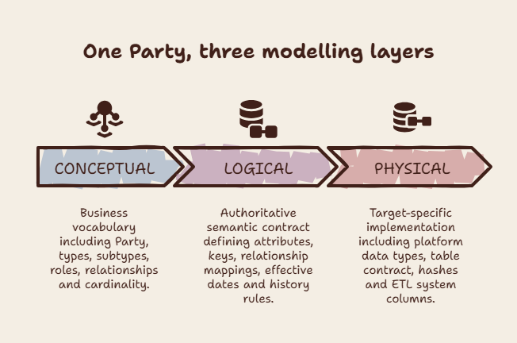
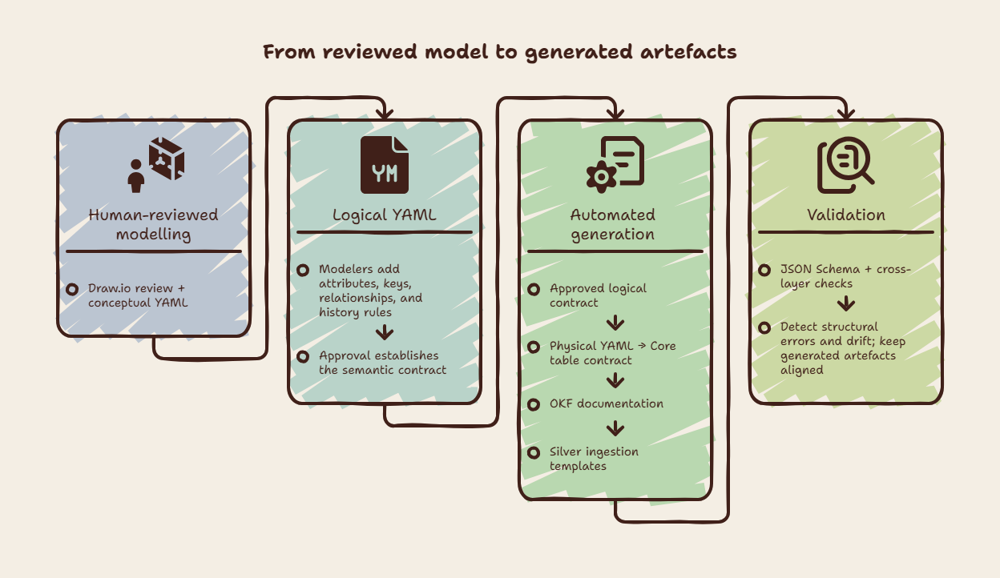

<!-- REVIEW:START -->
> ## Review
>
> **Editorial publishability: 4/5** — the human-review and automated-generation boundary is clear, but the closing cost-benefit claim still needs a concrete basis.
> **Proofreading gate: Required** — no current proofreading report was found for this draft.
>
> **Intended audience: Technical**
>
> **Manager (M): 3/5** — the payoff and maintenance burden are now named, but the closing trade-off remains too general to guide an investment decision.
> **Technical (T): 4/5** — the parseable Party examples, history strategy, and generation boundary show a workable mechanism; the physical excerpt needs its illustrative scope stated.
>
> **What to change**
> 1. Give "Why the separation matters" a concrete example of ongoing review, generation, and drift-checking effort alongside the benefit of one approved change flowing downstream.
> 2. Label the YAML in "The physical layer" as a selected excerpt with an illustrative schema name, so it is not mistaken for the complete production contract.
> 3. Qualify the closing claim that a model is a prerequisite for AI by naming the specific AI-assisted work that requires this semantic contract.
>
> **Platform fit**
>
> Medium: 4/5 — the walkthrough stands alone; make the closing trade-off specific before publishing.
> LinkedIn Newsletter: 3/5 — the value of the human-to-automation boundary is present; bring it ahead of the YAML detail.
> dbt Slack / Blog: 3/5 — the contract and generation topics fit; centre the framing on the dbt-facing artefacts.
> r/dataengineering: 3/5 — the model-driven approach is relevant; lead with the operational trade-off it creates.
>
> _Reviewed against: 01_project_summary, 02_core_principles, 05_style_and_voice, 06_content_boundaries. Date: 2026-09-28._
<!-- REVIEW:END -->

# Metadata-driven modelling of the core data layer
*The previous articles established the need for a documented Core Data Model and explained why Universal Data Model principles are useful for representing business meaning. This article describes how YAML can implement the model.*

The implementation separates the model into conceptual, logical, and physical layers. Each layer answers a different question and gives each decision one authoritative home:
- **Conceptual:** What business concepts and relationships exist?
- **Logical:** What is the complete business structure, including attributes, keys, and history rules?
- **Physical:** How is that logical contract implemented in a target platform?

The separation keeps business meaning independent from implementation detail. It also creates a controlled generation path: conceptual definitions provide the vocabulary, logical YAML provides the semantic contract, and physical YAML projects that contract into a Fabric-compatible structure. When meaning is introduced in pipelines and manually maintained documentation there is a constant need to deal with conflicting definitions.

<figure>
  
  <figcaption>Figure 1. The Party concept moves from business vocabulary to a complete semantic contract and then to a target-specific implementation.</figcaption>
</figure>

## One example across the layers: Party
`Party` is a useful example because it is a shared business concept with many forms and relationships. A Party can represents internal and external relations, including companies, people, and organisational units. It is a regular entity, with subtypes such as `Location`, `Contact`, `Organisation`, `Employee`, and `Organizational Unit`.

Party also participates in many relationships. It can have contact mechanisms and identifications, fulfill party roles, participate in work-effort roles, play roles on invoices, and have status, terms, or geographic associations. The conceptual layer records these business relationships without deciding how their columns will be stored.

## The conceptual layer: the business vocabulary
The conceptual layer describes the business language of the model. In the implementation, the conceptual model is held as a collection of entities and relationships in `conceptual.yml`, with a Draw.io representation available for visual review.

A simplified conceptual definition for Party looks like this:

```yaml
id: conceptual.party
label: Party
name: conceptual.party
description: All internal and external relations. Either companies or people or organizational units etc.
entitytype: regular
tags:
    - party
relationships:
    - id: conceptual.rel.party_to_party_supertype
      label: is a
      source: conceptual.party
      target: conceptual.party_supertype
      cardinality: 1:1
    - id: conceptual.rel.party_to_party_roles
      label: fulfills
      source: conceptual.party
      target: conceptual.party_roles
      cardinality: 1:N
    - id: conceptual.rel.party_to_party_contact_mechanism
      label: has
      source: conceptual.party
      target: conceptual.party_contact_mechanism
      cardinality: 1:N
```

The complete implementation contains more relationships, but the important boundary is visible in this excerpt. The conceptual layer defines the entity, its description, its UDM classification, and the cardinality of its relationships. It does not define columns, hash components, SQL types, table names, or ETL system fields.

This layer is where modelling decisions should be reviewed with business stakeholders. Before adding a new entity, the question is whether the proposed concept is genuinely new, a type, a subtype, a role, or a relationship between concepts that already exist. That decision belongs in the business vocabulary before implementation detail is introduced.

## The logical layer: the semantic contract
The logical layer turns the conceptual vocabulary into a complete business structure. The logical Party definition is stored as `logical.party.yml`. It retains the conceptual identity through `derivedfrom: conceptual.party` and adds the information required to build and use the entity:

- primary and alternate keys
- business attributes and generic data types
- foreign-key attributes
- relationship attribute mappings
- confidentiality metadata
- effective dates and history behaviour

The logical definition of Party includes a generated hash-key placeholder, a business key, and business attributes:

```yaml
id: logical.party
label: Party
name: logical.party
description: All internal and external relations. Either companies or people or organizational units etc.
entitytype: regular
derivedfrom: 
    - conceptual.party
keys:
    primary:
        - party_key
    alternates:
        - name: business_key
          columns:
            - party_id
            - record_source
            - party_type_key
columns:
    - id: logical.party.party_key
      name: party_key
      description: Hash key (primary key) derived from business key columns
      dataType: string
    - id: logical.party.party_type_key
      name: party_type_key
      description: Fk to party_type (classifies)
      dataType: string
    - id: logical.party.party_id
      name: party_id
      description: Identifier for the party in the source system
      dataType: string
    - id: logical.party.party_name
      name: party_name
      description: Name for the party
      dataType: string
```

The logical layer also carries the relationships from the conceptual model, now with explicit attribute mappings. For example, the Party-to-Party-Role relationship maps `party.party_key` to `party_roles.party_key` with cardinality `1:N`.

History is a logical modelling decision as well. Party uses the `driving_key_set` strategy with `party_hk` as its driving key and `load_datetime` as the ordering value. The history grain therefore follows the Party entity key. Other entities may use a different driving-key set when several related records must change together.

The logical layer is the authoritative semantic contract. It is detailed enough to drive documentation and generation, while remaining independent of actual table names, SQL physical types, hash algorithms, and operational process columns.

## The physical layer: a target-specific projection
The physical layer implements the logical contract for a target platform. The Party physical definition is stored as `physical.party.yml` and projects the entity to the `party` table in the `core` schema.

The physical file resolves generic logical types into Fabric SQL types and adds implementation details. A simplified example for a `party` is: :

```yaml
id: physical.party
entity: party
table: core.party
schema: core
derivedfrom:
- logical.party
business_columns:
    - name: party_id
      logical_type: string
      physical_type: varchar(1024)
      nullable: true
      derivedfrom:
      - logical.party.party_id
    - name: party_name
      logical_type: string
      physical_type: varchar(1024)
      nullable: true
      derivedfrom:
      - logical.party.party_name
hash_columns:
    - name: party_hk
      hash_type: primary_key
      nullable: false
      ref_entity: party
      primary_compose_from:
      - party_id
      - record_source
      - party_type_hk
    - name: party_type_hk
      hash_type: foreign_key
      nullable: false
      ref_entity: party_type
system_columns:
    - name: load_datetime
      physical_type: datetime2(3)
      nullable: false
    - name: cdc
      physical_type: varchar(1)
      nullable: false
    - name: record_hk
      physical_type: varchar(64)
      nullable: false
    - name: process_run_id
      physical_type: varchar(1024)
      nullable: false
```

The physical definition adds the Data Vault 2.0 hash implementation. `party_hk` is a `varchar(64)` surrogate key derivedfrom `party_id`, `record_source`, and the Party Type reference. `party_type_hk` is a foreign-key hash pointing to `party_type`.

It also adds ETL-only columns such as `load_datetime`, `cdc`, `record_hk`, `process_run_id`, and `current_record`. These fields support loading, change detection, and current-record selection. They are part of the physical contract, not the business meaning of Party.

The boundary matters. A Fabric datatype, table name, hash component, or CDC flag can change when the target implementation changes. The business definition of Party, its identity, and its relationships should remain stable.

## From metadata to generated artefacts
The three layers form a generation path rather than three independent descriptions:
<figure>
  
  <figcaption>Figure 2. Human approval establishes the logical contract; generation and validation carry it into aligned implementation and documentation artefacts.</figcaption>
</figure>

Human review continues through the logical layer. Modellers review the conceptual vocabulary in Draw.io and YAML, then enrich the logical model with attributes, keys, relationships, and history rules. Approval of the logical YAML establishes the semantic contract: this is where decisions about business meaning are made.

From that contract, generation is automated. Physical generation applies target-platform rules for types, hashes, nullability, table metadata, and ETL columns; documentation generation produces the OKF entity pages, including descriptions, keys, relationships, history behaviour, and Silver SQL templates. These outputs still need validation, but they should not introduce new semantic decisions. A change in meaning starts with human review of the model and then flows through the generated artefacts.

This reduces duplication of efforts. Changes in the logical layer introduce a change flow though the entire stack where each change is pre-defined.  

## YAML, Draw.io, and validation
YAML is used as version-controlled model metadata. The conceptual model is held as a collection, logical entities are split into one file per entity, and physical entities have one target-specific file each. This makes changes reviewable in source control and allows tooling to work on a single entity without loading the whole model into an editor.

Draw.io provides a visual editing and review surface, especially for the conceptual model. The implementation stores synchronisation metadata inside the artefacts, including source paths and content hashes. A conversion can therefore compare content rather than relying only on timestamps.

Each layer has a JSON Schema. The conceptual schema validates entity identifiers, labels, entity types, controlled values, and relationship cardinalities. The logical schema validates entity structure, keys, columns, relationships, `derivedfrom` references, and globally unique column identifiers. The physical schema validates target tables, business columns, hash columns, system columns, and history configuration.

Schema validation catches structural errors early. Custom validation adds rules that a basic JSON Schema cannot express easily, such as uniqueness across all entity column identifiers and cross-layer consistency. This distinction is important: the schema defines what a valid document looks like, while custom validation checks relationships and constraints across the assembled model.

## Synchronisation and drift
The model is a chain: Draw.io, conceptual YAML, logical YAML, physical YAML, source mappings, dbt models, and generated documentation. A change in one layer can make the chain inconsistent if the derived artefacts are not updated.

The practical rule is simple: changes should flow deliberately through the layers, and validation should run after generation. This makes the model easier to edit while keeping the generated contracts, documentation, and implementation aligned.

## Why the separation matters
The conceptual layer makes the model reviewable as business vocabulary. The logical layer makes semantic decisions explicit and reusable. The physical layer makes those decisions executable on a target platform.

For the Party example, one stable business concept can therefore drive a documented `core.party` contract, a history implementation, source-to-Core ingestion templates, generated OKF documentation, and downstream analytical models. Each artefact has a clear role, and the relationships between artefacts are visible rather than implicit.

These benefits have to be set against the costs of maintaining the YAML models. Keeping the models in synch is a serious task, that requires a considerable effort.

Do the benefit outweigh the costs: I think often it can, and if the goal is to use AI having a model of your data is a prerequisite.

The next article examines the logical layer in greater depth. It explains why logical YAML is the authoritative change surface for the physical contract, dbt models, documentation, and AI-assisted modelling work.
